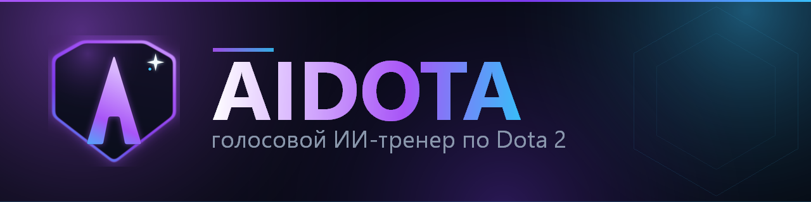
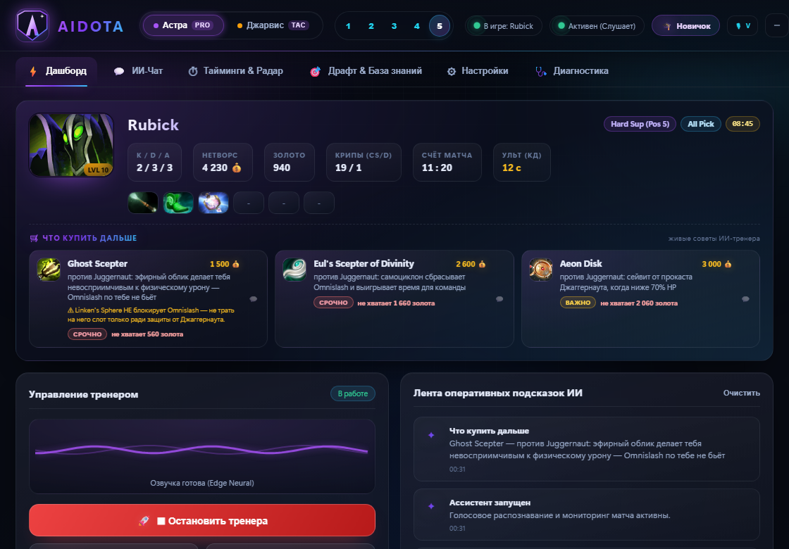
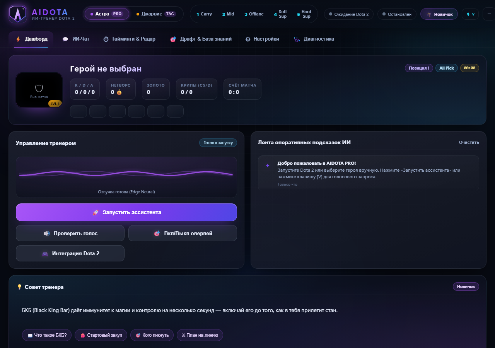
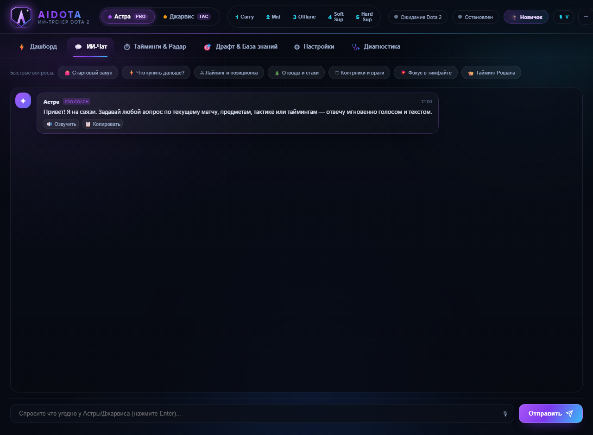
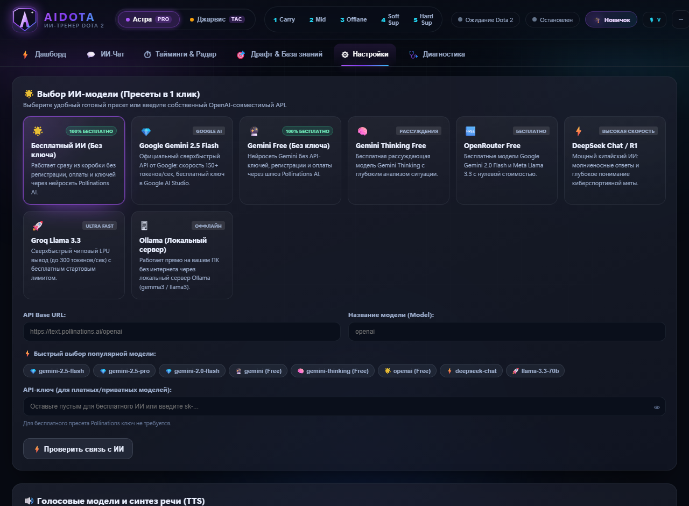

<div align="center">



# AIDOTA

**Голосовой ИИ-тренер по Dota 2:** Астра и Джарвис слушают игру, видят матч через GSI,
дают точечные советы, разбирают ваши матчи и учат играть — от первого ластхита до
профи-таймингов.

[](LICENSE)
[](requirements.txt)
[](#требования)
[](#тесты-и-качество)
[](CHANGELOG.md)

[Установка](#установка) · [Возможности](#возможности) · [Скриншоты](#скриншоты) ·
[Команды](#голосовые-команды) · [Разработка](#разработка) · [Сборка](#сборка-установщика)

</div>

---

## Установка

1. Скачайте **`AIDOTA_Setup.exe`** из раздела **Releases** вашего репозитория
   (или соберите сами — см. [docs/BUILD.md](docs/BUILD.md)).
2. Запустите установщик и следуйте инструкциям (установка не требует прав
   администратора; при желании добавьте ярлык на рабочий стол и автозапуск).
3. Откройте **AIDOTA** — при первом запуске создастся `config.json` с настройками
   по умолчанию. Компактная русская модель Vosk уже входит в установщик, поэтому
   голосовое распознавание работает сразу.
4. Во вкладке **«Настройки»** выберите микрофон, динамики, уровень игры и
   (по желанию) вставьте API-ключ ИИ. Без ключа доступен бесплатный резервный ИИ.
5. Во вкладке **«Диагностика»** нажмите **«Подключить к Dota 2 (GSI)»** и
   **«Добавить в Steam»** — и можно запускать тренера во время матча.

> **Важно:** установщик собран без пользовательского `config.json` — ваши ключи и
> настройки никогда не попадают в дистрибутив и репозиторий.

## Скриншоты

| Живой матч: герой, нетворс, предметы и советы по закупке |
|---|
|  |

| Дашборд | ИИ-чат |
|---|---|
|  |  |

| Настройки и уровень игры |
|---|
|  |

## Возможности

| | Возможность |
|---|---|
| 🧠 | **Умный ИИ-тренер.** Тактический брифинг по GSI (стадия, роль, герой, золото, инвентарь, угрозы, паверспайки, цели, ошибки), подбор знаний под конкретный вопрос, tool-loop с инструментами и защита от галлюцинаций. |
| 🎓 | **Четыре уровня игры.** Новичок — объяснение терминов и простые шаги; Любитель — баланс; Опытный и Профи — тайминги, темп карты, окна драфта, экономика байбека и контроль объектов без разжёвывания основ. |
| 📚 | **База знаний на всех 127 героев.** Контр-предметы, контрпики, синергии, порядок прокачки, билды по ролям с таймингами, Аганим и Шард. |
| 🗣️ | **Голосовые тренеры Астра и Джарвис.** Нейросетевые голоса Edge TTS, офлайн-откат на Windows SAPI, обращение по имени. |
| 🎙️ | **Голосовое управление в матче.** Push-to-Talk или свободный микрофон, офлайн-распознавание речи Vosk, команды на естественном языке. |
| 🪟 | **Игровой оверлей.** Полупрозрачная карточка поверх Dota 2 с плавным появлением, логотипом и индикатором прослушивания; скрывается по `Alt+Z`. |
| ⚡ | **Живой GSI-контекст.** Счёт, время, KDA, нетворс, предметы, драфт, руны, Рошан, Терзатель, аегис — тренер видит всё то же, что и вы. |
| 📈 | **Разбор сыгранных матчей.** OpenDota + ИИ: фарм, KDA, тайминги предметов, бенчмарки, сравнение закупа с эталонным билдом и персональные советы. |
| 🎯 | **Драфт и контрпики.** Рекомендации героев под вражеский драфт и вашу позицию, объяснение сильных и слабых сторон. |
| 📺 | **Живой HUD в оверлее и дашборде.** Герой, уровень, золото, нетворс, KDA, время матча, инвентарь и кулдаун ультимейта обновляются из GSI в реальном времени. |
| 🛒 | **Советы по закупке с объяснением «почему».** Блок «Что купить дальше» прямо в дашборде: предмет под текущего врага, его цена, нехватка золота и причина — например, Ghost Scepter против Omnislash Джаггернаута или MKB против уклонений Фантомки. |
| 🩺 | **Самодиагностика.** Проверка микрофона, звука, модели Vosk, GSI-портов, Dota 2 и доступа к API в один клик. |
| 💾 | **Память между матчами.** Реплики, уроки разборов и частые ошибки сохраняются локально и учитываются в следующих ответах. |
| 🎨 | **Современный интерфейс.** Тёмная тема, стеклянные панели, градиенты, анимации, логотип, splash-экран, toast-уведомления и уважение к `prefers-reduced-motion`. |

## Уровни игры

Настройка **«Уровень игры»** меняет стиль и глубину ответов тренера:

| Уровень | Что получите |
|---|---|
| 🐣 **Новичок** | Тренер объясняет термины в скобках (БКБ, байбек, вижн, ластхит), даёт один простой шаг и короткое «почему». |
| ⚔ **Любитель** | Объясняет сложные моменты, но уже даёт тактические советы и тайминги. |
| 🧠 **Опытный** | Минимум основ: паверспайки, темп карты, тайминги вижна и смоков. |
| 👑 **Профи** | Глубокая аналитика: окна драфта, экономика байбека, контроль объектов, разбор решений. |

Попробуйте в чате: *«что такое бкб?»*, *«что собрать против фантомки?»*,
*«кого пикнуть против медузы?»*, *«что качать на пудже?»*.

## Требования

| Компонент | Назначение | Обязательно |
|---|---|---|
| Windows 10 / 11 | Оверлей, SAPI, глобальные хоткеи, WebView2 | Да |
| Dota 2 + Steam | GSI и чтение ситуации матча | Для матчей |
| Интернет | Нейросетевые голоса, OpenDota, облачный ИИ | Для онлайн-функций |
| API-ключ ИИ (DeepSeek / OpenRouter / Groq / OpenAI / Gemini) или Ollama | Умные советы и разбор матчей | Рекомендуется (есть бесплатный резерв) |
| Python 3.10–3.15 | Только для запуска из исходников и сборки | Для разработки |
| Модель Vosk `vosk-model-small-ru-0.22` (~87 МБ) | Офлайн-распознавание речи | Входит в установщик |

## Голосовые команды

Называйте тренера по имени (**Астра** или **Джарвис**):

| Фраза | Действие |
|---|---|
| *«Астра привет»* / *«Джарвис, ты тут?»* | Приветствие и проверка связи |
| *«Что такое БКБ?»*, *«Объясни, что значит байбек»* | Простое объяснение терминов |
| *«Что купить на пуджа»*, *«Сборка на сфа»* | Закупка, раскачка и тактика |
| *«Что купить дальше»*, *«Что собрать против них»* | Предмет под текущую минуту и драфт |
| *«Кого мне пикнуть»*, *«Кого взять из моих»* | Герой из вашего пула под драфт |
| *«Разбор матча»*, *«Последний матч»* | Послематчевый разбор через OpenDota и ИИ |
| *«Мои ошибки»*, *«Что я делаю не так»* | Разбор текущего матча по GSI |
| *«Совет»*, *«Как играть»*, *«Ситуация»* | Оценка обстановки на карте |
| *«Драфт»*, *«Кого банить»* | Анализ пиков и банов |
| *«Мета»*, *«Топ героев»* | Сильнейшие герои патча по винрейту |
| *«Статус»*, *«Что по игре»* | Время, счёт, герой, KDA, предметы, цели |
| *«Я мид»*, *«Я тройка»*, *«Я полная поддержка»* | Смена игровой позиции |
| *«Скрой окно»* / *«Покажи окно»* | Скрыть/показать оверлей (или `Alt+Z`) |
| *«Настройки»* | Открыть окно параметров |
| *«Замолчи»*, *«Стоп»* / *«Включи голос»* | Отключить/включить озвучку |
| *«Выход»*, *«Пока»* | Завершение работы |

## Горячие клавиши

| Клавиши | Действие |
|---|---|
| **`Alt+Z`** | Скрыть / показать оверлей поверх игры (настраивается) |
| **`V`** | Push-to-Talk: зажмите для голосового ввода (настраивается) |
| `—` / `⚙` в окне оверлея | Свернуть оверлей / открыть настройки |

## Архитектура

```
main.py                 Точка входа и CLI-команды
build_exe.py            Сборка exe + AIDOTA_Setup.exe (PyInstaller + Inno Setup)
installer.iss           Скрипт установщика Inno Setup
AIDOTA.spec             Спецификация PyInstaller
config.example.json     Пример конфигурации (без секретов)
default_preset.json     Пресет настроек по умолчанию
docs/
  BUILD.md              Как собрать приложение и релиз
  BEGINNER_RELEASE.md   План апгрейда «тренер для новичков + релиз»
  COACH_UPGRADE.md      План и контракты умного тренера
aidota/
  gui_app.py            Главное окно и веб-дашборд (pywebview) + Tk-фолбэк
  web_app.py            API-мост между веб-интерфейсом и ядром
  web/                  HTML/CSS/JS интерфейс (style-modern.css — дизайн-система)
  tray.py               Системный трей Windows (pystray)
  app.py                Оркестратор: микрофон → команда → тренер → оверлей/TTS
  beginner.py           Уровни игры, глоссарий терминов, планы и упражнения
  coach.py              Логика тренера: провайдеры LLM, контекст, память, инструменты
  coach_brain.py        Тактический бриф по GSI, подбор знаний, промпты, санитайзер
  coach_memory.py       Долговременная память (data/coach_memory.json)
  meta_db.py            База знаний на 127 героев: билды, контрпики, прокачка
  commands.py           Парсер команд со строгой активацией по имени тренера
  context.py            GSI-контекст, радар угроз, детектор ошибок, авто-подсказки
  hotkeys.py            Глобальные клавиши (Win32) — Alt+Z, PTT, мышь
  overlay.py            Игровой оверлей с анимациями и логотипом
  tts.py                Нейросетевые голоса Edge TTS + SAPI fallback
  settings_gui.py       Вспомогательные функции настроек (проверка API, звук)
  dota_api.py           Клиент OpenDota API и кэширование
  dota_install.py       Steam-интеграция, установка GSI, single-instance mutex
  skills/               Макро-таймеры, кулдауны, лайн-матчапы
  roles.py, heroes.py   Роли 1–5, каталог героев и нечёткий поиск
  vision.py             Определение героя под курсором
data/                   Снапшоты OpenDota (герои, предметы) + рантайм-память
hero_icons/             Иконки героев
assets/                 Логотип, иконки, баннер и скриншоты для README
tests/                  Набор из 481 автоматических тестов (unittest)
```

## Разработка

```bat
python -m venv .venv
.venv\Scripts\python.exe -m pip install -r requirements-dev.txt

# Запуск из исходников
.venv\Scripts\python.exe main.py
.venv\Scripts\python.exe main.py --text       :: текстовый режим

.venv\Scripts\python.exe main.py --doctor     :: диагностика
```

### Тесты и качество

```bat
.venv\Scripts\python.exe -m unittest discover -s tests -t .
```

- **481 тест** (unittest), все зелёные; CI — `.github/workflows/ci.yml`
  (Windows, Python 3.12/3.13).
- Отдельные наборы: `test_beginner_coach.py`, `test_coach_smart.py`,
  `test_meta_db_extra.py`, `test_context_extra.py`, `test_release_readiness.py`.
- Никаких сетевых вызовов в тестах — только фикстуры и мок-сессии.

### Сборка установщика

```bat
.venv\Scripts\python.exe build_exe.py
```

Скрипт собирает `dist\AIDOTA\AIDOTA.exe`, добавляет модель Vosk и запускает
Inno Setup (`installer.iss`) → `AIDOTA_Setup.exe` в корне проекта. Версия берётся
из `aidota/__init__.py`. Полная инструкция — [docs/BUILD.md](docs/BUILD.md).

## Конфигурация и приватность

- `config.json` **не коммитится** и не попадает в установщик — создаётся при первом
  запуске из `default_preset.json`; пример — `config.example.json`.
- API-ключи хранятся локально (при сохранении обфусцируются), в репозиторий и
  установщик не включаются.
- Память тренера (`data/coach_memory.json`) и профиль игрока
  (`data/player_profile.json`) — локальные файлы, их можно удалить в любой момент.
- Приложение работает офлайн: база знаний и таймеры доступны без сети; интернет
  нужен для нейросетевой озвучки, OpenDota и облачного ИИ.

## Диагностика и частые вопросы

<details>
<summary><b>Нет звука при ответах</b></summary>

Проверьте устройство вывода в «Настройках» и интернет для Edge TTS. При отсутствии
сети используется Windows SAPI.
</details>

<details>
<summary><b>Тренер не видит матч</b></summary>

Откройте «Диагностику», нажмите «Подключить к Dota 2 (GSI)», перезапустите Dota 2.
Параметр запуска `-gamestateintegration` должен быть в свойствах игры в Steam.
</details>

<details>
<summary><b>Не работает определение героя под курсором</b></summary>

Включите в Dota 2 режим «В окне без рамки» (Borderless Windowed) — в эксклюзивном
полноэкранном режиме Windows блокирует захват экрана.
</details>

<details>
<summary><b>Голосовое распознавание не работает</b></summary>

В установщик входит компактная модель Vosk. Для большей точности скачайте большую
модель `vosk-model-ru-0.22` из интерфейса и перезапустите приложение.
</details>

<details>
<summary><b>ИИ отвечает ошибкой ключа</b></summary>

Ключ истёк или неверен — обновите его в настройках. Без ключа можно выбрать
бесплатный пресет (Pollinations) в один клик.
</details>

## Лицензия и благодарности

Проект распространяется по лицензии [MIT](LICENSE). Сторонние компоненты и их
лицензии перечислены в [THIRD_PARTY_NOTICES.md](THIRD_PARTY_NOTICES.md).

- Dota 2 и связанные материалы — торговая марка Valve Corporation; проект не
  аффилирован с Valve.
- Спасибо сообществам [OpenDota](https://www.opendota.com/),
  [Vosk](https://alphacephei.com/vosk/), [Edge TTS](https://github.com/rany2/edge-tts)
  и [CustomTkinter](https://github.com/TomSchimansky/CustomTkinter).

<div align="center">

Сделано с ❤️ для игроков Dota 2. Если проект помог — поставьте ⭐ репозиторию!

</div>
